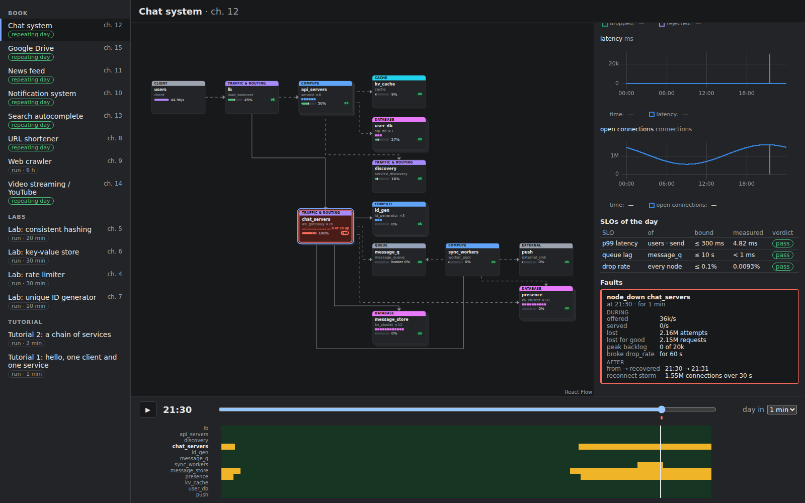

# system-sim

**A system design simulator you can play with.** Describe a distributed system, push a day of
traffic through it, and watch where it bends: the boxes in the diagram turn yellow, then red.



*The chat system from the book at 21:30, when its gateway tier goes down. The diagram, the charts
and the table of service levels all follow the same clock.*

## What it is

System design interviews ask you to size a system on paper: how many servers, what cache, which
database, and will it hold at the peak? Paper cannot tell you whether you were right. system-sim can.

You write a system in a short YAML file (clients, load balancers, caches, SQL and NoSQL stores,
queues, CDNs, datacenters and the links between them), say how much traffic it gets over a day,
and the simulator runs that day in seconds, a minute at most. It reports which parts saturate, how long requests take,
what gets dropped, and whether the service levels you promised were met.

It started as a way to practise the systems in *System Design Interview* by Alex Xu (volume 1),
and to learn and teach modern C++ along the way.

## What you can do with it

- **Watch real systems live through a day.** Eight systems from the book are included, each sized
  with the book's numbers: a URL shortener, a news feed, a chat system, a web crawler, YouTube, and
  more. Open the web page and watch a day pass in a minute: the evening wave builds, a gateway goes
  down at 21:30, the reconnect storm follows.
- **See failures and recovery.** Take a node, or a whole datacenter, down on a schedule and watch
  the damage spread and heal.
- **Try your own ideas.** Change a number (more replicas, a bigger cache, a different shard count)
  and rerun to see what it does. A sweep tries a whole grid of values and shows where the system
  tips over.
- **Check the arithmetic.** An instant mode gives the steady-state load on every node at any time
  of day, the back-of-the-envelope estimate with the simulator doing the sum.
- **Learn the building blocks.** Four small labs (consistent hashing, a key-value store, a rate
  limiter, unique ids) and two tutorials start from one box and add one idea at a time.

## A taste

A small system: clients call an API tier, which calls a database once for each read and twice for
each write.

```yaml
version: 1
name: chain
duration: 2m
nodes:
  users: {type: client, rate: {base: 1.5k/s}, ops: {read: 0.8, write: 0.2}, timeout: 1s}
  api:
    type: service
    replicas: 2
    capacity: 1k/s
    latency: 0.5ms
    ops:
      read:  [{to: db, op: select}]
      write: [{to: db, op: select}, {to: db, op: insert}]
  db: {type: service, capacity: 5k/s, latency: 2ms}
links:
  - {from: users, to: api, dir: inout}
  - {from: api, to: db, dir: inout}
slo:
  - {metric: p99_latency, node: users, op: read, max: 20ms}
  - {metric: drop_rate, max: 0}
```

(This is [`scenarios/tutorial/chain`](scenarios/tutorial/chain/), trimmed of a comment or two.) Run it and you get the verdict:

```
node   mean_rho  peak_rho  dropped
api        0.75      0.75        0
db         0.36      0.36        0

status  metric       node   op     observed  max
PASS    p99_latency  users  read   14.8ms    20ms
PASS    drop_rate    -      -      0         0
```

The API tier is three quarters busy and the database a third. Add 40 % more traffic and the API tier
goes red first. That is the kind of question the tool is made to answer.

## How it works, in a paragraph

Instead of simulating every single request, the simulator treats traffic as a flowing quantity:
each node receives a rate of requests and answers at its capacity, and queueing theory (the same
formulas operations researchers use for call centres and checkout lines) says how long the queue is
and how long a request waits. Because it works with rates, a whole day takes from a few seconds to about a minute, and the same
file with the same seed always gives the same result, down to the byte. The price is that it shows
the shape of what happens to a system, not the fate of an individual request.

## Try it

You need CMake, Ninja and GCC 14 (or Clang 19/20), plus Node 22 for the web page.

```bash
# build and test the simulator
cmake --preset gcc14-release && cmake --build --preset gcc14-release

# run one of the book's systems from the terminal
./build/gcc14-release/simsys run scenarios/book/url-shortener/scenario.yaml

# or watch them all in the browser
cd web && npm ci
npm run precompute -- --simsys ../build/gcc14-release/simsys    # about 3 minutes
npm run serve                                                    # http://localhost:4173
```

## What this project shows

- **Systems thinking:** the book's designs modelled end to end, each sized in a README that
  works through its arithmetic, and every modelling choice written down, including what the model
  leaves out.
- **Modern C++23:** named modules, concepts, ranges, `std::expected` and more, in a codebase where
  every new language feature is explained where it first appears. Built with three compilers and two
  standard libraries.
- **Engineering discipline:** tests written before the code and named after the property they prove
  (over a thousand of them), continuous integration across three compilers and the address, undefined
  behaviour and thread sanitizers, and a written record of every design decision.
- **A full-stack tool:** a strict TypeScript and React web app that reads the simulator's output
  through a documented, versioned contract.

## Where it is going

Done: the engine and the book's eight systems, scheduled failures, parameter sweeps, the web page
that plays each system's day. Next: **design challenges**, where *you* build the system. A challenge
gives a load and the service levels; you choose servers from a price list and wire them together; the
simulator says whether your design holds and what it costs a month against a reference design. Later:
random failures, and a hosted version that runs in the browser.

## Learn more

- [Technical reference](docs/reference.md): every command and flag, how each part works, the
  status of every phase.
- [The scenario language](docs/scenario-schema.md): what you can write in a YAML file.
- [Study notes](docs/study/README.md): one note per modern C++ feature used in the code.
- [The web app](web/README.md) and [the design challenges plan](docs/superpowers/specs/2026-11-12-phase6-design-challenges-design.md).
- [Contributing](CONTRIBUTING.md): the project's rules.

## About

Built by Lior Koren as an educational project: to practise system design, and to learn and teach
modern C++. MIT licence, see [LICENSE](LICENSE).
